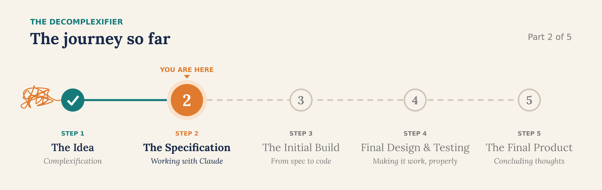
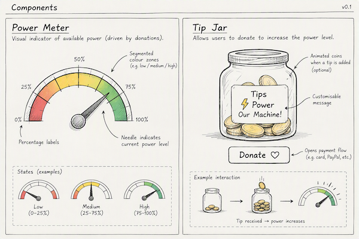

# The Decomplexifier, Part 2: The Specification

> *In part 2 of the Decomplexifier, we're going to start our rather ambitious project. But before we do, a little bit of background on me.*

## A confession: I'm not a developer

I am definitely not a developer by any stretch of the imagination, although I did start my career as a developer, working in C# and database technologies. However, I've not programmed for an extremely long time. I can read the average program, and I've developed a few websites and HTML tools, but I am by no means a programmer.

So, whilst I have very good and creative ideas, I would struggle to code them. That's part of the excitement of having a tool such as Claude Code, or another AI tool, to actually help write my code.

## The one lesson I brought with me

My background in software does give me a few skills that are going to be pertinent to our Decomplexifier story. The first is that **you don't just jump into writing code**.

Or I should say, I sometimes *did* jump into writing code, and it never went particularly well. Sure, for a small project or a small tool, that might be fine. But for something larger, you definitely need to break it down, and write and agree a specification, including things like how you're going to test it and how you're going to architect it. I knew that much.

So in this blog entry, we're going to cover the first step we took in building the Decomplexifier: working with an LLM, in this case Claude, to come up with a specification.

## Round 1: A simple prompt and a first draft

The first thing I did was make sure Claude had an area to work in. I'd already set this up in Claude Code for some of my other coding projects.

I started with a simple, and probably not the best, prompt. As you can see below, it basically just says that I'm going to build an online tool that takes things in, processes them and decomplexifies them. I started out wanting this to be **whimsical**, which is the word I put in the prompt. I also told Claude to help me write the specification for how it would work, to challenge me, to ask me questions and to refine it, **but not to write any code yet**. I think that's a key first step, although I found that Claude will often jump to this anyway.

![[Pasted image 20261029094118.png]]

What came back was a draft product specification to work on, put together entirely by Claude. It covered:

- **An overview.** This defined the core idea: we take in a process, and a step stays only if it produces the outcome, meets a hard rule, or prevents a failure that's likely or costly. It also outlined the solution's boundaries, for example, no real-time collaboration.
- **Likely users and use cases.**
- **A first go at the whimsy.** This included a machine that you feed documents into, with visuals; steps that get cut landing in a bin; playful tags; and the phrase "FAF", which I really liked. There was also the idea of a serious mode that turns off the jokes for people who just want to use it. Importantly, the spec made clear that this is a serious tool, even if it has whimsy around it, and that the output is a decomplexified process.
- **Functional requirements.** A whole bunch of them.
- **The AI pipeline.** How we would ingest a process, interrogate it, and split the prompts up to make the best use of the AI.
- **Architecture and tech stack.**
- **Privacy, safety and success metrics.**
- **Some thoughts on testing.**

The Claude window also summarised the plan: creating a minimal viable process from something complicated, the work the AI would do, how we'd make it whimsical, and how we'd cover safety and the use of AI.
## Round 2: Answering Claude's questions

The draft also contained a number of open questions, things I hadn't told Claude in my initial prompt, which I had to go away and answer:

| Claude's question                     | My answer                                                                                                                                                        |
| ------------------------------------- | ---------------------------------------------------------------------------------------------------------------------------------------------------------------- |
| **Who is it for?**                    | Individuals first, to play around with.                                                                                                                          |
| **Free or paid?**                     | I really like the idea of it being free, but it needs an API to an LLM, and that costs money. This needed more thought, and led to the cost analysis in Round 3. |
| **What's the character?**             | I really liked the idea of the machine, but not Claude's early name or ideas, so we refined them.                                                                |
| **Should it suggest automation?**     | Yes, but kept separate, so it doesn't dilute the original idea.                                                                                                  |
| **Should the scoring be adjustable?** | Useful, but we don't want it too complicated or too harsh. That led to four modes: *light dusting*, *spring clean*, *declutter* and *scorched earth*.            |
| **On-premise version?**               | No. I see this working on the web, in the cloud.                                                                                                                 |
| **The name?**                         | Claude suggested one I didn't like, so we clarified it would be called **the Decomplexifier**.                                                                   |

![The four modes: light dusting, spring clean, declutter and scorched earth][software_modes.png]]

After I'd answered all those questions, Claude updated the product specification, which was now in detail.

## Round 3: Doing the real arithmetic

I wanted this to be free, but there's clearly going to be a cost for the API. So Claude ran some numbers, looking at the different APIs that could be used and the estimated cost per run. Initially, Claude guessed this would be just a few pence per run. It turns out it's a little bit more expensive than that.

In the end, we decided to go with:

- **A fixed monthly cap on the API**, with something in the user interface that shows when there's no money left.
- **A tip jar.** This was my suggestion: people using the tool could give money, which becomes credit that everybody can use.
- **A power meter on the machine**, showing how much power it has, or how much money is left in the API fund.

That led to a whole new section in the brief, because we'd now need to take money and pay it into an API account.

## Round 4: How will we build and test it?

Following this, we had another iteration of the design document, and we started to ask how we'd go about building and testing it. We decided:

- The first thing we'd build is **a very simple web page to test the flow end to end**.
- We'd make sure we had **quality tests**, and that the machine was actually doing the sensible part it was designed to do.
- The **input should be quite broad**, as there are many different kinds of process.

And then we realised that, to build and test, we'd need **a whole bunch of test cases**: real processes, along with decomplexified versions of them to test against.

## The result

At the end of this step, we had a very detailed specification, with a number of decisions made, and some homework for me to go away and do.

**[![[The Decomplexifier — Product Specification.pdf]]

I think this is a sensible first step for any reasonably sized software project. In fact, I could have spent more time editing and refining the document, maybe consulting other humans, or other LLMs, to improve it.

## Five takeaways

So let's review where we've got to this week with our specification. Here are a few key takeaways:

1. **Writing the specification as a shared document works really well.** I typed my answers to the questions inline, and Claude was able to rewrite them straight into spec changes.
2. **There's still a lot of human in this process.** The test cases I write for the complex processes are going to do most of the work in testing and training the LLM.
3. **The cost estimate was wrong the first time round.** It needed a separate step to do the real arithmetic, and that shaped the whole business model, which moved from free, to capped, to a capped model with a tip jar.
4. **Quality needs quality tests and a well-understood mechanism.** There was quite a bit of work refining the specification to make sure it met that.
5. **Excluding things from the design is important.** We agreed there would be:
   - no paid plans
   - no on-premise version
   - no adjustable weights
   - no spending time on the design and front end before the back end has been built

These are all quite important decisions which wouldn't have been made if we hadn't gone through this refinement step.

## Next time

I look forward to joining you for episode 3, when we work to build out the solution, and see just how it goes and whether our decisions were the right ones.
