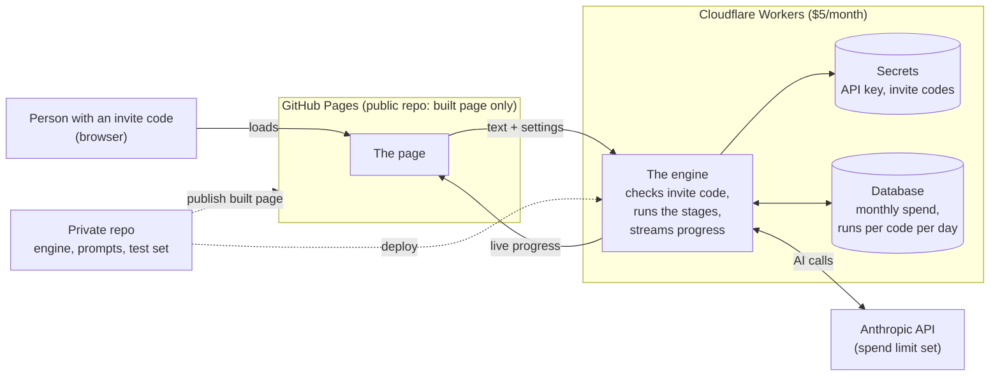

# The Decomplexifier, Part 3: The Initial Build (from Spec to Code)
![[decomplexifier-journey-step-3.png]]

> *In part 3 of the Decomplexifier, we're going to turn our specification into an initial build, which involves quite a lot of refinement!*

Well, hello and welcome to part 3 of the Decomplexifier. I'm wondering now if I've jumped in too deep. I don't know. But I think the journey so far continues to tell us a lot about how we can work with AI to build more detailed software solutions, and hopefully you're still following along. So let's jump in.

## Where we left off

If you remember, at the end of [[The Decomplexifier - Week 2 - The Specification|part 2]] we had a specification, written by AI but assisted by me. It covered the basic stages the Decomplexifier needs to run: ingesting the information, mapping it out, distilling it, scoring it and presenting it.

We'd also defined a way of testing it: a set of existing processes, plus my own "gold" answers for each of the six public-sector test cases.

It's worth pointing out that this involved me reading each of those six public-sector processes in detail and working out what a good answer would look like. One of the common misconceptions about AI development is that you just point AI at a problem statement and it writes the code, with no further need for refinement or human intervention. In simple projects without a complicated architecture, such as simple web pages or tools that solve one specific task, that can be the case. But something more complicated needs a conversation, just as it would if you had a team of human programmers working on it.

## Building the engine and a test bench

So the first job in this phase was to build the underlying engine, plus a **test bench** to run the tests and score them.

I worked with Claude to build:

- a **command-line tool** that runs the engine, calling Claude's API whenever it needs the LLM;
- a **small test web page** for watching the runs live and scoring them.

All of this was tested locally first against a free, offline **"stub"** that stood in for Claude's API and gave deliberately bad answers. The stub's answers failed most of the quality checks, which is exactly what we wanted: it proved the checks worked and could catch bad results before we paid for a single real answer.

## The test plan

Once that was working, we developed a test plan together, with four kinds of test:

| Kind | Count | What it checks | How it's marked |
| --- | --- | --- | --- |
| **Public-sector processes** (FOI, lasting power of attorney, tax penalties, expenses, incident reporting) | 6 | Real bureaucracy, where legal steps must survive | An AI judge against my gold answer, plus my own 1–5 score |
| **Slick processes** (Scrum, Kanban, GitHub flow, registering to vote) | 4 | That the machine doesn't over-cut something already lean | Automatically: the core activities must survive |
| **Deliberately bloated processes** | 3 | How much it can cut, and whether it finds the bloat we planted | Automatically: planted items binned, must-keep steps kept |
| **Edge and difficult cases** | 4 | Failing kindly, and ignoring instructions hidden in a document | Automatically: the right error, or normal behaviour despite the trap |

And there were three ways of marking them:

1. **Automatic checks on every run.** Is every original step accounted for? Was the minimal viable process kept intact? Did the calls to the AI model stay within time and budget?
2. **An AI judge** for the public-sector tests, marking each result against my gold answer.
3. **My own human score, from 1 to 5,** for the public-sector results at every level of decomplexification. It really answers one question: *would I hand this simplified process back to the person who owns it?*

If a result didn't meet the quality criteria, we made changes. Nothing was going to be spent on design or hosting until the machine passed.

## Four rounds of testing

Each round followed the same loop: **run the tests, read the failures, decide whether the machine or the test was wrong, fix it, and run again.**

### Round 1: not harsh enough

Our first live run was 23 tests, costing about $2.70.

The good news was that all of the cases behaved reasonably well. The edge cases failed kindly, and the hidden instructions in the hostile document were ignored.

The bad news was that **it wasn't harsh enough.** The Decomplexifier was keeping far too many steps: public-sector results came back with 8–12 steps, where my gold answers had 5–6 stages. It was also costly, and took a long time; one long tax manual cost $0.44 and took three and a half minutes.

We also found mistakes in the tests themselves, with some checks measuring the wrong things.

### Round 2: stages, and choosing a model

Next, we told the machine to distil the main journey into **3–7 memorable stages**, which is the level all my gold answers worked at. Step counts fell straight into line.

We also compared two models for the Interrogate stage, and measured the average cost per run:

| | Haiku | Sonnet |
| --- | --- | --- |
| Average cost per run | $0.078 | $0.097 |
| Average time / slowest | 56 s / 126 s | 44 s / 79 s |
| Must-keep controls kept (AI judge) | 4 of 6 | 5 of 6 |

Sonnet cost about 2 cents more, but it judged controls better and was faster, so it became the default.

This round also threw up more errors, such as the LLM failing at steps and needing to be retried. Most of those retries turned out to be bookkeeping slips, like a step listed in two places, and each one cost a whole extra AI call. So we moved those repairs into ordinary code, and kept AI retries for real problems only.

### Round 3: the first good results

Round 3 is where we started to get good results. The cost came down, the retries were kept down, and the scores went up:

| | Round 2 | Round 3 |
| --- | --- | --- |
| Runs with no failed checks | 7 of 17 | **11 of 17** |
| Average cost per run | $0.097 | **$0.079** |
| Retries | 7 | **1** |

We finally had a solution that was passing the tests. When I scored the six public-sector results at Spring clean, **all six scored 5.**

This round also threw up a new problem. The bin contained steps that had genuinely been binned, *and* steps that had been merged into other steps, and that felt unclear. So we changed the specification. Every binned step now says:

- **Why** it's going;
- **Instead**: what happens instead;
- **Change**: what's different, so a merge shows that we're altering a step rather than binning it completely.

### Round 4: the harshness modes

Round 4 tested all four harshness modes (light dusting, spring clean, declutter and scorched earth), and it taught us the most:

- **The documents were mapped differently every time.** The same document came out as 35, 29 or 24 steps on different runs, which made it hard to compare the modes. The fix was to **create the map once and reuse it for every mode**, which also makes it easier for a user to understand.
- **The complexity score didn't show how harsh a mode was being.** Counting the steps actually removed did, and that showed the modes were working.
- **Declutter wasn't reliably harsher than Spring clean.** We reworked its prompts so that each mode can see the whole ladder: *"remove everything the gentler modes remove, plus…"*. After that, every mode removed more than the one below it, in every test.

All of this was done with me scoring the results for the different modes and feeding those scores back. My Scorched earth scores averaged 4.3, with two 3s, and those two 3s turned out to be the most useful scores of the whole phase (more on that below). After the changes they prompted, I re-scored both as 5, and both modes passed the quality gate.

## Locking it down and going live

After those four rounds of testing, we were able to **lock down the requirements** before building a basic front end. We froze the specification at this point, so the front end has a fixed list of events and fields to build against.

Then we worked out how to deploy it, and an architecture to support that.

### Choosing where it lives

A run takes about 45 seconds on average, and up to three and a half minutes at worst. So whatever hosts the engine has to hold a connection open for that long, and keep the API key secret.

We looked at some free options and at a small always-on server. In the end, I decided I wanted to host this on GitHub with the rest of my code. But GitHub Pages only serves static files, which meant it couldn't keep an API secret or run the AI pipeline.

So we split the system in two:

- **The page** is published to GitHub Pages from a separate public repository, which contains only the built page. The engine code, prompts and test documents stay private.
- **The engine** runs on a **Cloudflare Worker**, which also holds the API key as a secret.

For now, it's protected by an **invite code**, capped at 10 runs per code per day, with a **monthly budget** on the API that stops runs when it's spent. The tip jar is visible but not live yet.

One surprise: Cloudflare's free tier wouldn't fit. It allows 10 milliseconds of processing per request, and a run uses 26–72 milliseconds, so the engine needs Workers Paid at $5 a month.

Here's roughly the architecture we ended up with:

### What going live found

Once it was deployed, we ran the six public-sector tests through the live engine, and the live site found three faults the test bench couldn't:

- **Every run was rejected**, because secrets set by hand on Cloudflare weren't what we thought.
- **Runs that failed through the machine's own fault still used up a code's daily allowance.** They no longer count.
- **The fuel update arrived after the result**, when the result should come last.

Once those were fixed, all six passed every check on the live site.

## What did we learn?

So what are the main takeaways from this phase?

1. **A lot of the failures were the tests.** Round after round, a check was too rigid or measuring the wrong thing. Fixing the tests is part of testing itself. AI can help with that, but you have to go through the process.
2. **Marking had to work at every level.** We had automatic checks and an AI judge, but there's no getting away from a human doing the actual scoring, which I did for all of the different harshness levels.
3. **Move work from the AI into the code wherever you can.** It makes runs cheaper, faster and more predictable.
4. **The most useful insight came from my own low scores.** Two of my lower scores showed that the faff often lives in the organisation's *policy*, not in the process itself. That became **policy challenges**: on Scorched earth, the machine now lists up to three rules you could challenge, with the change, the gain and the risk. It could end up being a great feature for the tool.
5. **Measure the right thing for the user.** The complexity score was fine for the engine, but it didn't show harshness. Asking *"what does the user actually need to see?"* gave us a different way of scoring it: the **de-faff meter**, a single figure for how much of the original process no longer happens every time.
6. **It's important to actually go live.** Several things only appeared when we deployed to the live site.
7. **It doesn't come for free.** The testing phase cost about **£17 in AI calls**, even while we worked on getting the cost down.

## Where we are now

So, at the end of all that, as you can see from the screenshot, we have a live site. It can take in documents and prompts and run them through the decomplexification process. It's currently locked away behind an invitation code.

![[decomplexifier_screenshot.png]]

In week 4, we'll move on to the final design and testing, to make it work really well and, hopefully, look really good.
